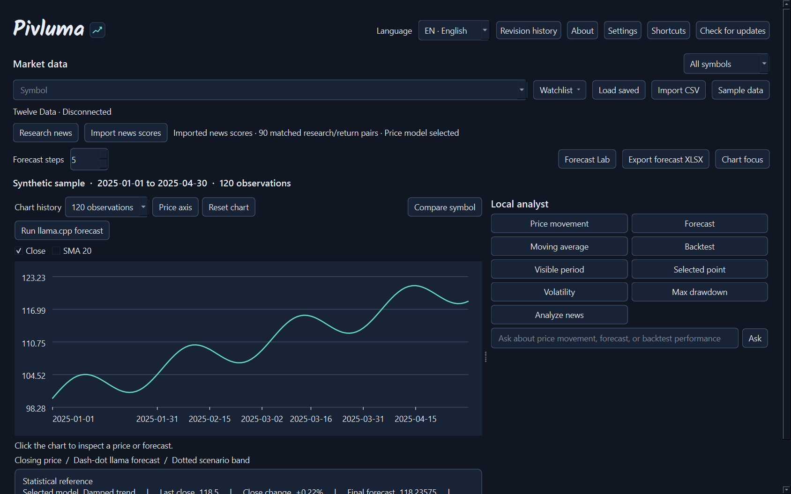

# Pivluma

Pivluma is a Windows desktop application in development for financial forecasting and market analysis.



## Current release

[Pivluma 0.15.1](https://github.com/muratkorayozkan/Pivluma/releases/tag/v0.15.1) is the current release. Download the [portable Windows x64 ZIP](https://github.com/muratkorayozkan/Pivluma/releases/latest), extract it, and run Pivluma.exe. The themed Windows Setup EXE is available on the same release page, alongside the standalone MSI. Setup starts with the Windows light or dark preference and offers a theme switch. It installs to `C:\Program Files\Pivluma` with a Start menu entry. Its desktop shortcut option is selected by default and can be cleared during setup. Windows requests administrator approval for the MSI.

The forecasting engine compares a last-price baseline, linear trend, damped trend, and exponentially smoothed level. At each origin it uses only completed prior forecasts to select a model, using recent errors at several lead times. The dashboard reports the selected model and compares the full selection strategy against the last-price baseline on the same walk-forward origins. Forecast intervals use empirical errors for each step.

The desktop dashboard and built-in analyst support English, Turkish, and Simplified Chinese. Kraken public crypto data and ECB daily reference rates work without account setup. A configured Twelve Data feed can extend coverage. A portable Windows package can be built from source. Live verification with a Twelve Data account is pending.

## Run the desktop app

From the repository root on Windows with Python 3.10 or newer:

```powershell
python -m venv .venv
.\.venv\Scripts\python.exe -m pip install -r requirements-desktop.txt
.\.venv\Scripts\python.exe -m pivluma.desktop
```

The application starts maximized with standard Windows caption buttons and connects to BTC/USD. Press **Esc** to restore the window size or **F11** to toggle maximization. Choose **Sample data** to work with a synthetic series. The chart shows recent closing prices, the forecast, its empirical interval, and walk-forward error against a last-price baseline. Change **Forecast steps** to update the analysis. The maximum is 120 steps when there are enough observations for walk-forward evaluation. Choose **Export forecast XLSX** to save an Excel workbook with the active symbol, last observation date, selected model, error metrics, forecasts, and interval bounds. To use your own data, enter a symbol and choose **Import CSV**. **Load saved** lists the symbols stored in the Windows application data directory. Select one to reopen its series from SQLite. The command-line database can be selected independently with `--database`.


Use the **Language** menu to switch between **EN · English**, **TR · Türkçe**, and **简体中文**. The selected language is remembered on this PC. Switching keeps the active prices and forecast horizon.

The chart and analyst appear side by side in wide windows and in separate tabs in compact windows. Choose **Chart history** to change the number of closing prices displayed. Use the mouse wheel over the plot to zoom and drag the plot left or right to move through history. Hover over a point for details, or click to select it. Use **Reset chart** to return to the latest 120 observations and automatic price scaling. The four layer toggles control closing prices, the 20-observation moving average, the forecast, and its interval. When the view moves away from the latest close, it shows historical data for that period. Click any historical or forecast point to inspect its value and, for a forecast, its interval. **Price axis** can set the lower and upper limits or restore automatic scaling.

The upper-right controls open revision history, the about page, and settings. **Settings → Theme** includes a Windows system option and light and dark palettes. The theme is remembered on this PC. Revision history loads recent published GitHub release notes.

The dashboard scrolls vertically when the controls, chart, and analyst response exceed the window height.

## Automatic updates on Windows

Install version 0.5.0 or newer once from the Windows ZIP on GitHub Releases. The portable executable checks for the latest stable release in the background. If a newer Windows ZIP is available, Pivluma verifies the GitHub asset's SHA-256 digest and size before preparing the package under the Windows application data directory.

Transient GitHub lookup failures are retried once. An icon beside **Check for updates** shows the current status. Hover over it for details. The update status distinguishes network, certificate, rate limit, local storage, and package verification problems.

When the update is ready, select **Open update** and confirm. Pivluma opens the prepared version, keeps the existing executable in place, and remembers the selected version when you reopen an older update-capable copy. Saved price series and the language preference are shared across versions. Source runs continue to use the repository checkout.

Use **Shortcuts** at the top right or press **F1** to view the keyboard commands. The app follows the Windows animation preference.

## Build the Windows package

On 64-bit Windows with 64-bit Python 3.10 or newer, run these commands from the repository root:

```powershell
python -m venv .venv
.\.venv\Scripts\python.exe -m pip install -r requirements-build.txt
.\scripts\build-windows.ps1 -Python .\.venv\Scripts\python.exe
```

The script builds and smoke-tests `dist/Pivluma/Pivluma.exe`, then creates `dist/Pivluma-0.15.1-Windows.zip` and prints its SHA-256 hash. Extract the entire archive and open `Pivluma.exe` inside the extracted folder. Keep the neighboring `_internal` folder with the executable. The build is unsigned and includes its own Python runtime.


## Connect live market data

Choose an instrument from the **Symbol** drop-down to switch the live chart automatically, or type a single code and press Enter. The live feed changes when you choose a symbol. Choose the same symbol again to retry a failed connection. Forecasting and export become available once sufficient history for the selected symbol arrives.

The symbol picker includes public Kraken crypto pairs against USD or EUR and six FX pairs. With a standard installation, Kraken supplies crypto history and quotes and the [European Central Bank](https://www.ecb.europa.eu/stats/policy_and_exchange_rates/euro_reference_exchange_rates/html/index.en.html) supplies daily FX reference rates. ECB rates are published on working days and are labeled as reference rates. When both currencies differ from EUR, Pivluma computes the cross rate from their EUR rates.

For installations managed by a data provider or administrator, an optional `TWELVE_DATA_API_KEY` in the process environment enables supported equity, ETF and FX data under the provider account's display rights. The public installer requires no key. You can also import equity and ETF history from CSV.

The chart uses daily REST history. If daily history is unavailable, Pivluma still tries the quote subscription and displays the history error separately from the stream state. The WebSocket quote is displayed separately in the Windows local time zone, with its UTC offset and marked as the last received quote after two minutes. Disconnecting keeps the latest quote visible and labels it as the last received quote. Switching to a sample or CSV series closes the live connection and clears the quote. The WebSocket connection and subscription acknowledgement have a combined 15-second deadline. If the provider rejects the subscription or the deadline expires, Twelve Data falls back to a REST quote when available. The app polls once per minute and labels the result as a one-minute bar. For other providers, reselect the symbol to retry. Once the subscription is accepted, the app can wait for a quote while the market is quiet. Sample data and CSV analysis work offline.

Provider references: [Kraken daily history](https://docs.kraken.com/api/docs/rest-api/get-ohlc-data), [Kraken ticker stream](https://docs.kraken.com/api/docs/websocket-v2/ticker), [REST API](https://twelvedata.com/docs), [WebSocket API](https://twelvedata.com/docs/websocket/websocket-getting-started), and [plans](https://twelvedata.com/pricing).


To build the themed Setup EXE and standalone MSI after building the portable package, run `./scripts/build-setup.ps1 -WixBin PATH_TO_WIX_BINARIES` with the WiX 3.14.1 binaries. This creates `dist/Pivluma-0.15.1-Windows-Setup.exe` and `dist/Pivluma-0.15.1-Windows-Setup.msi`.

## Cloud analyst

Select **Settings → Analyst model → Cloud analyst**, enter the base HTTPS URL of your deployed Pivluma gateway (for example, `https://analyst.example.com`) and the access code issued by its operator. No public gateway is configured by default. Pivluma appends the API path. The operator configures the SHA-256 hash of the access code as `PIVLUMA_ACCESS_SHA256` and sets `OPENAI_API_KEY` on the gateway server. The code stays in memory for the session. The calculated answer remains available if the service is down. A hosted gateway is required. [Server deployment](server/README.md)

## Use news in a forecast

For a supported live symbol the app requests daily news tone from [GDELT DOC 2.0](https://blog.gdeltproject.org/gdelt-doc-2-0-api-debuts/). If GDELT rate-limits a request, Pivluma respects the retry delay and uses saved GDELT scores when available. BTC can fall back to the separately labeled [Alternative.me Crypto Fear & Greed Index](https://alternative.me/crypto/fear-and-greed-index/), a market sentiment measure. Select **Research news** to retry or to start research from a saved price series. **Import news scores** also accepts a UTF-8 CSV with `date,tone` columns, ISO dates, and numeric tone scores from −100 to +100. Provide one score per day and use scores available at that time.

The forecast matches each historical price observation to the previous calendar day's news score. After at least 20 matched returns it can compare a bounded, news-adjusted candidate with the existing price models in walk-forward evaluation. The data panel shows the source, number of matched observations, and whether the current prediction uses the news model. Missing news leaves price-based forecasting available. Ask the analyst about news for the current result.

## Ask the local analyst

Use the analyst topic buttons or enter an English, Turkish, or Simplified Chinese question. **Visible period** summarizes the closing prices currently shown in the chart. **Selected point** explains the highlighted historical or forecast observation. Both shortcuts follow the chart as you change the selected point or visible period. The moving average uses the last 20 closes (or all available closes if fewer). Replies use the selected interface language. Try “How did the price move?”, “What is the forecast?”, or “How accurate was the model?”. Replies use the active series, date range, and forecast horizon. The built-in analyst matches supported topics and computes answers offline.

For natural-language explanations, install [Ollama for Windows](https://ollama.com/download/windows), run it locally, and pull one of the supported [Qwen3 models](https://ollama.com/library/qwen3), for example:

```powershell
ollama pull qwen3:4b
```

Select the installed model in **Settings → Local analyst model**. Pivluma sends the question and calculated facts only to the Ollama service at `127.0.0.1:11434`. The model is downloaded separately. Generated explanations appear below the calculated answer, which stays available if the model cannot respond.


## Try offline analysis

With Python 3.10 or newer, run these commands from the repository root:

```powershell
python -m pivluma --horizon 5
python -m pivluma --import-csv prices.csv --symbol DEMO --horizon 5
python -m pivluma --load --symbol DEMO --horizon 5
```

The first command uses 120 synthetic closing prices. The import expects a UTF-8 CSV with `date` and `close` columns. Use `YYYY-MM-DD` dates and positive finite closing prices. Each date must appear once. A five-step forecast needs at least 34 observations. Steps represent observations in the series.

A successful import replaces the stored series for that symbol in `pivluma.sqlite3`. Use `--database PATH` to choose another file. The output includes forecasts, empirical intervals and both walk-forward error scores.


## Run the tests

From the repository root, with Python 3.10 or later:

```powershell
python -m unittest discover -s tests
```

The data and forecasting tests use the Python standard library. Run the same command with the desktop dependencies installed to include the Qt tests. The market integration test runs local REST and WebSocket servers on loopback. It verifies the history request, subscription, quote timestamp, and disconnect without a Twelve Data account.

## Development

Commit and push directly to `main`. Update this README when features, setup instructions, or project status change. For each release, update the application version, verify the tests and Windows build, then tag the verified commit on main as vMAJOR.MINOR.PATCH and publish GitHub release notes with the verified Windows x64 ZIP attached.
